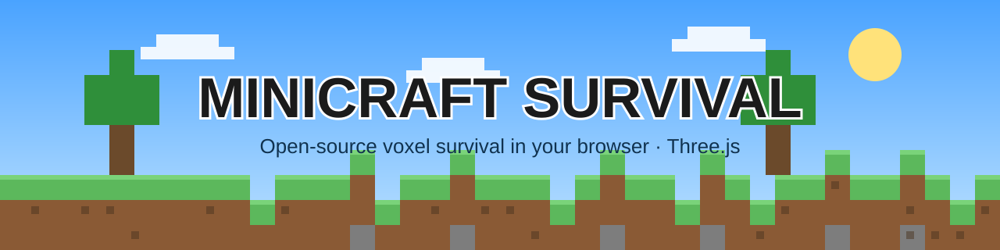

<div align="center">



# Minicraft Survival

**لعبة بقاء ثلاثية الأبعاد على المتصفح بأسلوب ماينكرافت، مبنية بـ Three.js. بدون تثبيت وبدون سيرفر.**

**A voxel sandbox survival game for the browser, in the style of Minecraft, built with Three.js. No install, no server.**

[](https://abdo-q.github.io/minicraft-survival/)
[](LICENSE)
[](https://threejs.org)
[](https://github.com/abdo-q/minicraft-survival/stargazers)
[](https://github.com/abdo-q/minicraft-survival/issues)

[العربية](#العربية) · [English](#english) · [Controls](#controls--التحكم) · [Contributing](CONTRIBUTING.md)

</div>

---

## العربية

### نبذة
**ماينكرافت المصغّرة (Minicraft Survival)** لعبة ساندبوكس وبقاء مفتوحة المصدر تعمل مباشرة داخل المتصفح باستخدام WebGL وThree.js. عالم مولّد عشوائيًا من المكعبات، تكسّر وتبني وتصنع وتبقى حيًّا. واجهة اللعبة بالعربية.

### المميزات
- عالم ثلاثي الأبعاد مولّد إجرائيًا (Procedural Generation) مع بيئات متنوعة مثل الصحراء والثلج والغابات.
- توليد التضاريس داخل Web Worker حتى يبقى الأداء سلسًا.
- نظام بقاء: تكسير المكعبات حسب الأداة ومستواها (فأس، معول، مجرفة) وخامات مثل الفحم والحديد والذهب والألماس.
- صناعة وبناء: طاولة صناعة، فرن، صندوق، مشاعل، زجاج، صوف وغيرها.
- دورة ليل ونهار مع شمس وقمر وغيوم.
- مؤثرات صوتية للخطوات والحفر.
- أكثر من عالم محفوظ تلقائيًا داخل المتصفح (localStorage).
- مسافة رسم تتكيّف تلقائيًا مع أداء جهازك.
- ملف HTML واحد، يمكن تشغيله بالضغط عليه أو استضافته في أي مكان.

### التشغيل السريع
1. **أونلاين:** افتح رابط GitHub Pages أعلاه.
2. **محليًا:** حمّل `index.html` وافتحه في المتصفح. تعمل اللعبة بدون إنترنت، عدا الموسيقى التي قد تُحمَّل من الإنترنت.
3. **سيرفر محلي (اختياري):**
```bash
git clone https://github.com/abdo-q/minicraft-survival.git
cd minicraft-survival
python3 -m http.server 8000
# ثم افتح http://localhost:8000
```

### التحكم / Controls
<a name="controls--التحكم"></a>

| الإجراء / Action | المفتاح / Key |
|---|---|
| تحرك / Move | `W` `A` `S` `D` |
| قفز / Jump | `Space` |
| Shift | `Shift` |
| اختيار عنصر من الشريط / Select hotbar slot | `1` – `9` |
| كسر وبناء / Break and place | الفأرة / Mouse |

> الأجهزة اللمسية مدعومة جزئيًا. التجربة الأفضل على الحاسوب.

### المتطلبات
متصفح حديث يدعم WebGL2 (Chrome أو Edge أو Firefox أو Safari). يُفضّل كرت شاشة ولو بسيط.

---

## English

### About
**Minicraft Survival** is an open-source voxel sandbox and survival game that runs entirely in your browser using WebGL and [Three.js](https://threejs.org). Explore a procedurally generated block world, mine resources, craft, build and survive. The in-game UI is in Arabic.

### Features
- Procedurally generated 3D voxel world with multiple biomes (desert, snow, forests and more).
- Terrain generation offloaded to a **Web Worker** for smooth framerates.
- Survival mining: block hardness, tool types and tiers (axe, pickaxe, shovel), ores such as coal, iron, gold and diamond.
- Crafting and building: crafting table, furnace, chest, torches, glass, wool and more.
- Day/night cycle with sun, moon and clouds.
- Footstep and block-dig sound effects.
- Multiple worlds, saved automatically in your browser (`localStorage`).
- Adaptive render distance based on your device performance.
- Single self-contained HTML file. Host it anywhere.

### Quick start
- **Online:** open the GitHub Pages link above.
- **Offline:** download `index.html` and open it in a browser.
- **Local server:**
```bash
git clone https://github.com/abdo-q/minicraft-survival.git
cd minicraft-survival
python3 -m http.server 8000
```

### Tech stack
| Area | Tech |
|---|---|
| Rendering | Three.js r158 (WebGL) |
| Audio | Howler.js 2.2.4 and WebAudio |
| Debug UI | lil-gui |
| Worker RPC | Comlink |
| Persistence | `localStorage` |
| Build | None. One static HTML file. |

### Project structure
```
.
├── index.html              # the entire game (code + bundled libraries + assets)
├── assets/banner.svg       # README banner
├── docs/                   # extra documentation
├── .github/                # issue and PR templates, Pages workflow
├── LICENSE                 # MIT (original code)
├── THIRD_PARTY_NOTICES.md  # licenses of bundled libraries
├── ASSETS_NOTICE.md        # trademark and asset disclaimer
├── CONTRIBUTING.md
├── CODE_OF_CONDUCT.md
├── SECURITY.md
└── CHANGELOG.md
```
See [docs/ARCHITECTURE.md](docs/ARCHITECTURE.md) for how `index.html` is organised.

### Roadmap
- [ ] Split `index.html` into modules (`src/`) with a Vite build
- [ ] Replace Minecraft-style assets with original or freely licensed ones
- [ ] Better mobile controls
- [ ] English UI toggle
- [ ] Screenshots and a short gameplay GIF

### Contributing
Pull requests are welcome. Read [CONTRIBUTING.md](CONTRIBUTING.md) first.

### License and credits
- Original code: [MIT](LICENSE) © 2026 abdo-q
- Libraries: see [THIRD_PARTY_NOTICES.md](THIRD_PARTY_NOTICES.md)
- Minecraft-related assets and trademark: see [ASSETS_NOTICE.md](ASSETS_NOTICE.md). This project is unofficial and not affiliated with Mojang Studios or Microsoft.

<div align="center">

If you like the project, give it a ⭐ on GitHub.

</div>
